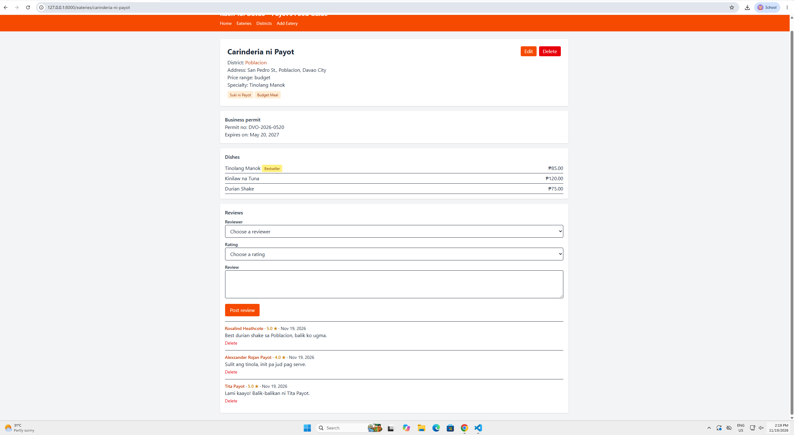

# Kaon Ta! Davao – Payot's Food Guide

Prefinal Milestone Project by **Alexzander Rojan Payot** (4-334 Full-Stack Development).

A Laravel 12 guide to Davao City carinderias and eateries: eateries by district, their permits, dishes, features, and reviews.

## Setup

```
composer install
cp .env.example .env
php artisan key:generate
touch database/database.sqlite
php artisan migrate:fresh --seed
npm install
npm run build
php artisan serve
```

## My personalized data

- Districts: Poblacion, Talomo, Agdao, Buhangin, Toril, Calinan
- Features: Suki ni Payot, Budget Meal, Halal, Open 24 Hours, Aircon, Free Wi-Fi
- Users (password `kaonta2026`):
  - Alexzander Rojan Payot – payot@kaonta.test
  - Tita Payot – tita.payot@kaonta.test
- My eatery: Carinderia ni Payot (`carinderia-ni-payot`), Poblacion, San Pedro St., Poblacion, Davao City, budget, Tinolang Manok
- My permit: DVO-2026-0520, expires May 20, 2027

## Relationships

| Relationship | Type | Why it fits |
|---|---|---|
| District and Eatery | hasMany / belongsTo | One district can have lots of eateries, but an eatery is only in one district, like Poblacion has many carinderias. |
| Eatery and Dish | hasMany / belongsTo | Each eatery has its own menu with many dishes, and a dish only belongs to that one eatery. |
| Eatery and Review | hasMany / belongsTo | People can leave many reviews on one eatery, but each review is only about one place. |
| User and Review | hasMany / belongsTo | One user can review a lot of eateries, but each review is only written by one person. |
| Eatery and Permit | hasOne / belongsTo | An eatery only has one business permit, that's why eatery_id is unique in the permits table. |
| Eatery and Feature | belongsToMany / belongsToMany | An eatery can be Halal and Budget Meal at the same time, and Halal is also used by other eateries, so I needed the eatery_feature pivot table. |
| District and Review | hasManyThrough | Reviews don't have a district_id, so I go through the eateries to get them. Example: Poblacion → its eateries → their reviews. |

## Routes

```
  GET|HEAD        / .................................................................... home › HomeController
  GET|HEAD        districts ....................................... districts.index › DistrictController@index
  GET|HEAD        districts/{district} .............................. districts.show › DistrictController@show
  GET|HEAD        eateries ........................................... eateries.index › EateryController@index
  POST            eateries ........................................... eateries.store › EateryController@store
  GET|HEAD        eateries/create .................................. eateries.create › EateryController@create
  GET|HEAD        eateries/{eatery} .................................... eateries.show › EateryController@show
  PUT|PATCH       eateries/{eatery} ................................ eateries.update › EateryController@update
  DELETE          eateries/{eatery} .............................. eateries.destroy › EateryController@destroy
  GET|HEAD        eateries/{eatery}/edit ............................... eateries.edit › EateryController@edit
  POST            eateries/{eatery}/reviews .................. eateries.reviews.store › ReviewController@store
  GET|HEAD        reviewers/{user} .................................. reviewers.show › ReviewerController@show
  DELETE          reviews/{review} ................................ reviews.destroy › ReviewController@destroy

                                                                                           Showing [13] routes
```

## Screenshots



